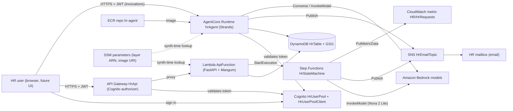
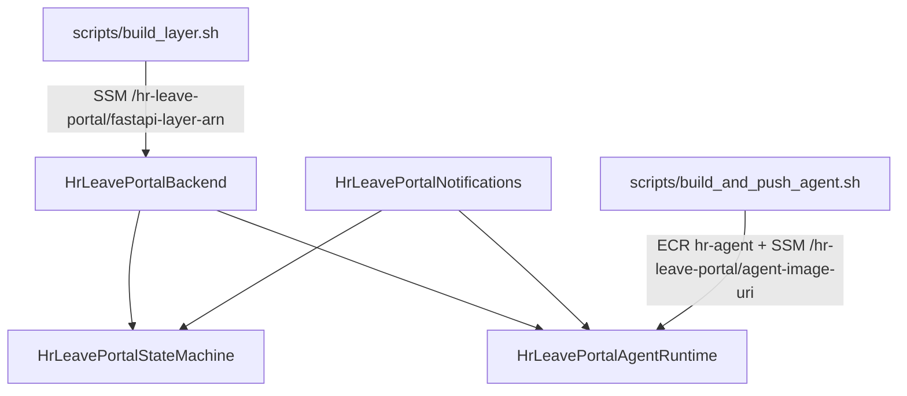
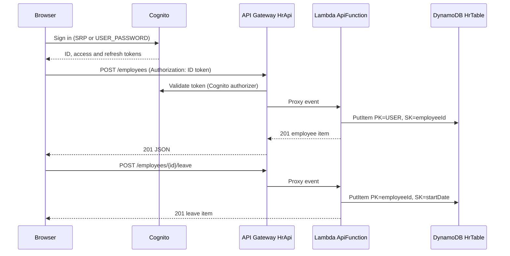
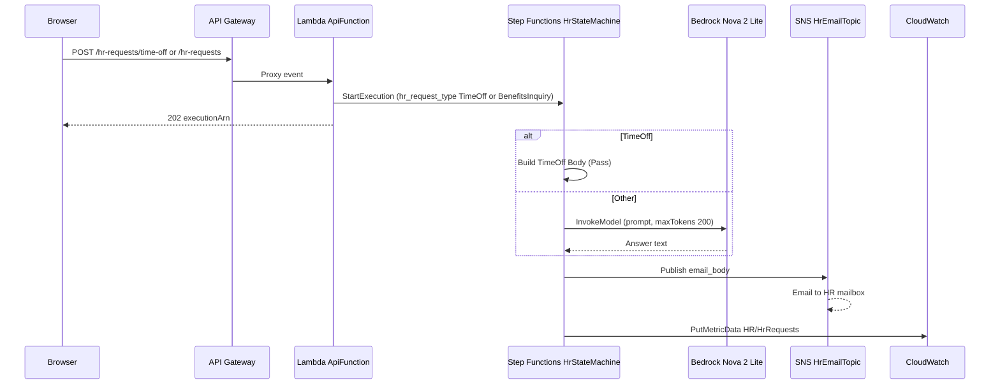
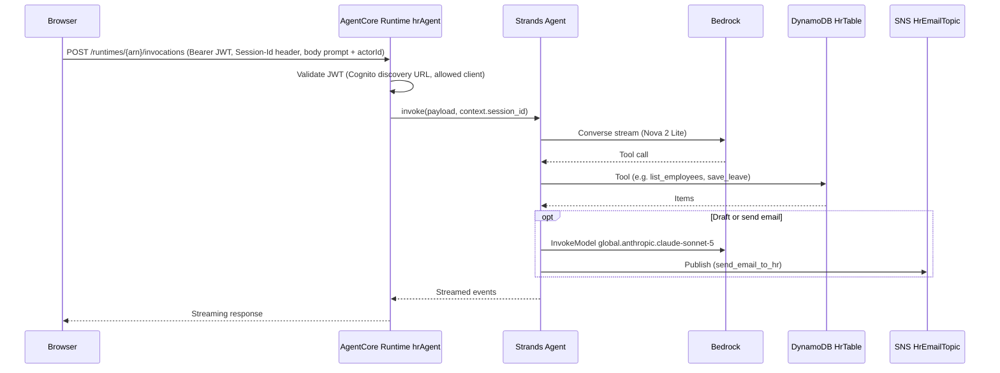

# Architecture: hr-leave-portal

## Architecture Analysis

### System Overview

A serverless AWS backend defined in AWS CDK (Python), deployed as four CloudFormation stacks from `app.py`:

| Stack (construct id) | File | Resources |
|---|---|---|
| `HrLeavePortalNotifications` | `hr_leave_portal/notification_stack.py` | SNS topic `HrEmailTopic` + email subscription |
| `HrLeavePortalBackend` | `hr_leave_portal/backend_stack.py` | DynamoDB `HrTable` (+ GSI1), Lambda `ApiFunction` (FastAPI layer from SSM), Cognito `HrUserPool` + `HrUserPoolClient`, API Gateway `HrApi` with Cognito authorizer |
| `HrLeavePortalStateMachine` | `hr_leave_portal/state_machine_stack.py` | Step Functions `HrStateMachine` (JSONata, from `state_machines/hr_state_machine_definition.json`), IAM role; injects `HR_STATE_MACHINE_ARN` into `ApiFunction` |
| `HrLeavePortalAgentRuntime` | `hr_leave_portal/agent_runtime_stack.py` | AgentCore `Runtime` `hrAgent` (container image from SSM), Cognito JWT authorizer, IAM grants |

No stack hosts a web front end, and the repo has no CI/CD pipeline.

### Architectural Style

Serverless, event-driven hybrid:
- Synchronous REST: API Gateway REST API (proxy) → one Lambda running FastAPI via Mangum (a "Lambdalith").
- Asynchronous workflow: the API starts Step Functions executions and returns `202` with the execution ARN.
- Agentic: a containerised Strands agent on AgentCore Runtime (HTTP protocol, arm64) with direct DynamoDB/SNS/Bedrock access, not going through the REST API.

### Component Relationships

Text fallback: The browser signs in with Cognito, then calls API Gateway `HrApi` and the AgentCore runtime `hrAgent`, each with a Cognito JWT. API Gateway checks the token against the user pool and proxies every request to the `ApiFunction` Lambda. The Lambda reads and writes the DynamoDB table and starts Step Functions executions. The state machine calls Bedrock (for non-TimeOff requests), publishes to the SNS topic (which emails HR) and writes a CloudWatch metric. The agent runtime checks the JWT with Cognito, then reads and writes the same DynamoDB table, publishes to the same SNS topic and calls Bedrock. The agent image comes from ECR; the Lambda layer ARN and the image URI are read from SSM at synth time.

### Stack Dependencies and Deployment Order

Text fallback: Run `scripts/build_layer.sh` before deploying the Backend stack, and `scripts/build_and_push_agent.sh` before the AgentRuntime stack. The StateMachine stack takes the topic from Notifications and the Lambda from Backend; the AgentRuntime stack takes the table and Cognito pool/client from Backend and the topic from Notifications. `StateMachineStack` also adds an environment variable and IAM policy onto the Backend Lambda, so CDK resolves a cross-stack reference in that direction too (`cdk.json` sets `@aws-cdk/core:defaultCrossStackReferences: "weak"`). This scan did not run `cdk synth`, so the final dependency graph is unverified.

### Data Flow

- **Single-table DynamoDB** `HrTable` (`PK`, `SK`, GSI1 on `GSI1PK`/`GSI1SK`, on-demand billing):
  - Employee: `PK=USER`, `SK=<employeeId>`, `GSI1PK=USER_BY_DATE`, `GSI1SK=<startDate>`.
  - Leave: `PK=<employeeId>`, `SK=<startDate YYYY-MM-DD>`; month filter uses `begins_with(SK, "YYYY-MM")`.
- Writes are `put_item` (create-or-replace); there are no condition expressions, so concurrent or repeated writes overwrite.
- HR requests are fire-and-forget: the API returns the execution ARN; no endpoint reports execution status or result.

### Authentication and Authorization

- **Cognito**: `HrUserPool` (email sign-in alias, self sign-up off, `RemovalPolicy.DESTROY`); app client `HrUserPoolClient` with `USER_PASSWORD` and `USER_SRP` auth flows, no client secret (CDK default), no hosted-UI domain, no groups, no OAuth settings beyond CDK defaults.
- **REST API**: `default_method_options` applies `AuthorizationType.COGNITO` with `HrAuthorizer` to every proxy method. With no OAuth scopes set, API Gateway expects the Cognito **ID token** in `Authorization`.
- **AgentCore Runtime**: `RuntimeAuthorizerConfiguration.using_cognito(user_pool, [user_pool_client])` sets a custom JWT authorizer (user pool discovery URL, allowed client = `HrUserPoolClient`). AgentCore's allowed-clients check reads the `client_id` claim, which is in the Cognito **access token**; confirm the expected token type at design.
- **Inside the services**: no authorization checks. The API does not read the caller identity; the agent takes `actorId` from the request body.

### CORS

- API Gateway: `default_cors_preflight_options` with `Cors.ALL_ORIGINS` and `Cors.ALL_METHODS` (OPTIONS preflight generated by CDK).
- FastAPI: `CORSMiddleware(allow_origins=["*"], allow_methods=["*"], allow_headers=["*"])`.
- No API Gateway Gateway Responses are defined, so authorizer 401/403 responses carry no CORS headers.
- AgentCore Runtime: no CORS configuration in this repo.

### Key Design Decisions

- Lambda dependencies come from a pre-published layer (`fastapi`, `pydantic`, `mangum`, `aws-lambda-powertools[tracer]`, x86_64, Python 3.14) whose ARN is stored in SSM; the Lambda asset is the `api/` folder only.
- The agent image is built locally (Finch by default, `linux/arm64`) and pushed to ECR by script; the URI goes to SSM; CDK reads it with `value_for_string_parameter`.
- The state machine definition lives as JSON; CDK patches `TopicArn` in before creating a `CfnStateMachine` (L1).
- The agent duplicates the API's DynamoDB access code instead of calling the REST API.
- `hrAgent/agentcore/agentcore.json` (AgentCore CLI project, `managedBy: "CDK"`) declares an `agentMemory` resource with four strategies, but the repo's CDK does not create it.

### Improvement Opportunities

- Restrict CORS origins to the UI's domain once it exists; add Gateway Responses with CORS headers for 4xx/5xx.
- Scope IAM `resources=["*"]` for `bedrock:InvokeModel` and `cloudwatch:PutMetricData` to specific model ARNs / a namespace condition.
- Derive `actorId` from the verified JWT (`sub`) instead of the request body.
- Provision AgentCore Memory in CDK and pass `MEMORY_AGENTMEMORY_ID`, or remove it from `agentcore.json`.
- Add an execution-status endpoint if the UI needs to show HR request results.
- Use `RemovalPolicy.RETAIN` for the table and user pool outside dev.

## Interaction Diagrams

### 1. Create employee / record leave (REST)

Text fallback: The user signs in with Cognito and gets tokens. The browser calls `POST /employees` with the ID token; API Gateway validates it and proxies to the Lambda, which writes the employee item and returns 201. Recording leave follows the same path and writes a leave item keyed by employee id and start date.

### 2. HR request (time off or general inquiry)

Text fallback: The browser posts a request; the Lambda starts a state machine execution and returns 202 with the execution ARN at once. The state machine builds a fixed email body for TimeOff requests, or asks Bedrock Nova 2 Lite for an answer otherwise, publishes the text to the SNS topic (which emails HR) and records a CloudWatch metric. The requester never receives the result through the API.

### 3. Chat with hrAgent (AgentCore Runtime)

Text fallback: The browser posts to the AgentCore data-plane invocation URL for the runtime ARN with a Bearer JWT and a session id header; the body holds `prompt` (or `messages`) and `actorId`. AgentCore validates the JWT against the Cognito pool and allowed client, then calls the Strands agent's entrypoint. The agent streams a conversation with Nova 2 Lite, which calls tools that read or write DynamoDB; the email tools call a Claude model on Bedrock and publish to SNS. Events stream back to the browser.
